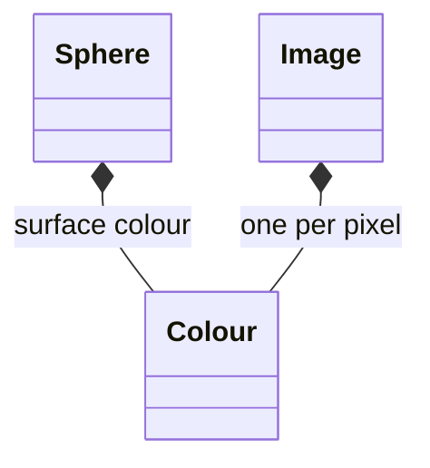

# Domain model

The current one-pixel demo traces a camera ray against one sphere. `trace`
decides the pixel colour: it returns the sphere's colour when the ray hits and
black when it misses.

`Sphere` currently owns a `Colour`. `Image` is a planned domain concept, not an
implemented class; it will hold the colours of its pixels. The current
`trace(const Ray&, const Sphere&)` function returns a `Colour`, and `main`
prints that result.
