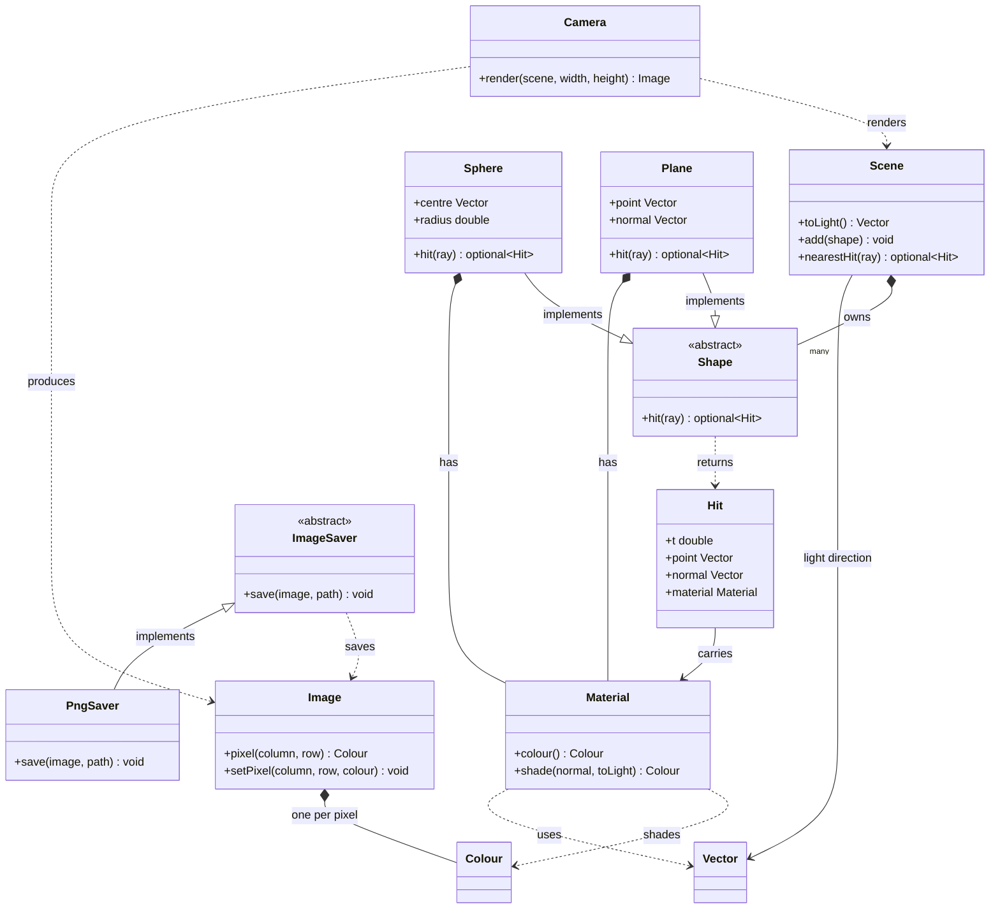

# Domain model

The camera creates a ray for each pixel and asks `trace` for its colour.
`trace` asks the `Scene` for the nearest hit, then asks the hit's `Material`
to shade it using the surface normal and the scene's direction towards the
light. The scene owns its shapes. Each shape has a material; a sphere and a
plane are the current shapes. A miss gives black. The camera stores the
resulting colours in an `Image`, and a saver writes it to a file.

`Shape::hit` returns the nearest hit in front of the ray origin, with a unit
normal, or no hit. `Sphere` and `Plane` implement that contract. `Scene`
compares the hits from all its shapes and keeps the nearest one. `Material`
holds a surface colour and applies Lambert's law. `Image` stores one `Colour`
per pixel, addressed by column and row from the top left. `ImageSaver` defines
the saving contract; `PngSaver` writes the whole image to the requested path
or throws `std::runtime_error`, so `Image` does not need to know about file
formats.
