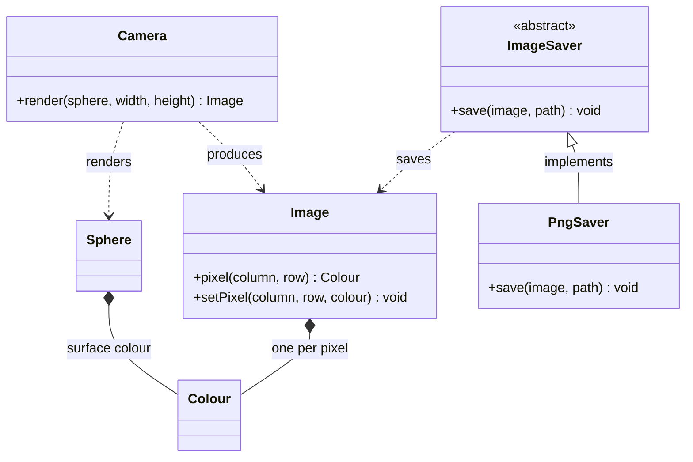

# Domain model

The demo renders a camera ray through every pixel, traces it against a sphere,
and stores the resulting colour in an `Image`. A hit gives the sphere's colour;
a miss gives black. `Camera::render` returns the completed image, and a saver
writes it to a file.

`Image` stores one `Colour` per pixel. Pixels are addressed by column and row
from the top left: `pixel(column, row)` reads a pixel, and
`setPixel(column, row, colour)` changes it. `ImageSaver` defines the saving
contract; `PngSaver` implements it for PNG files. The saver writes the whole
image to the requested path or throws `std::runtime_error`, so `Image` does
not need to know about file formats.
